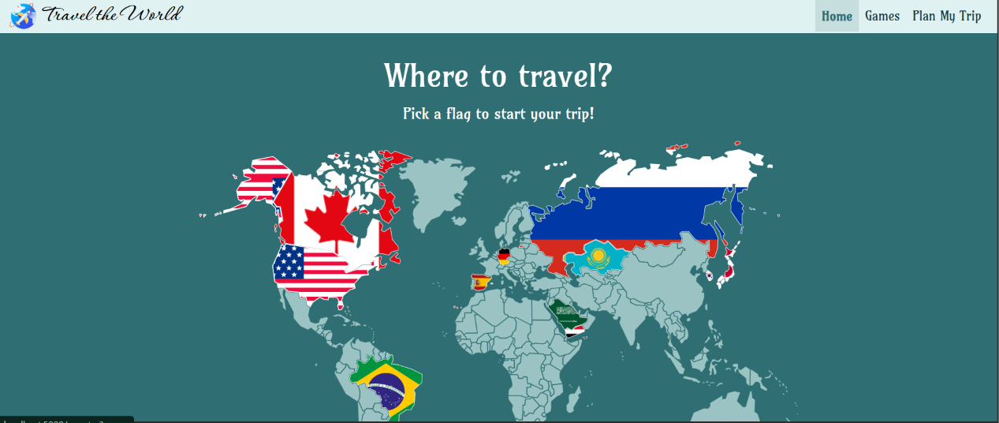
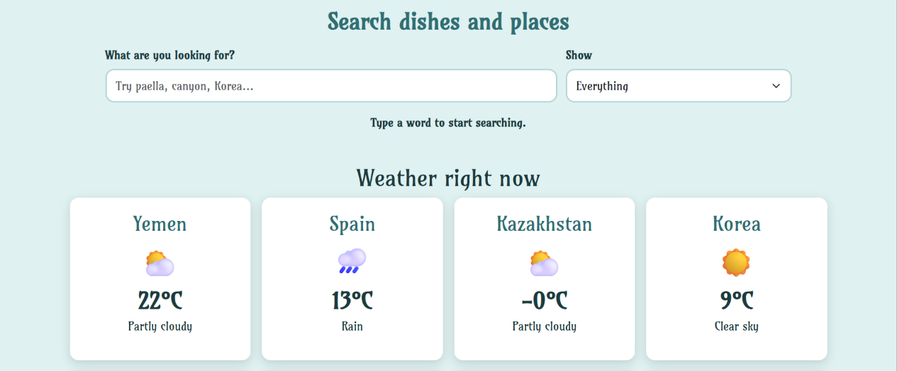
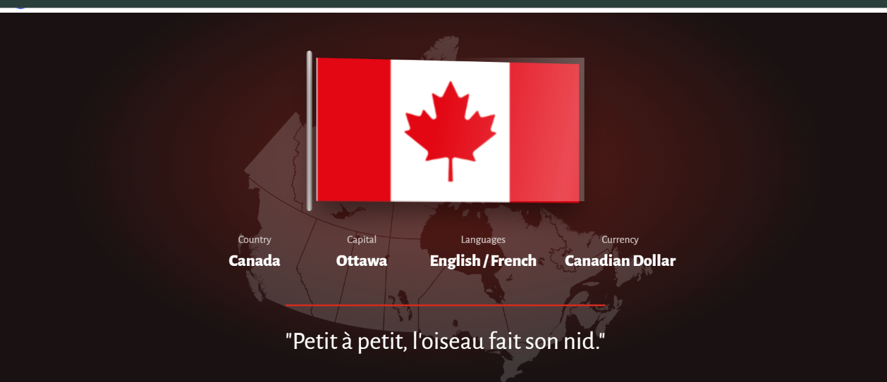
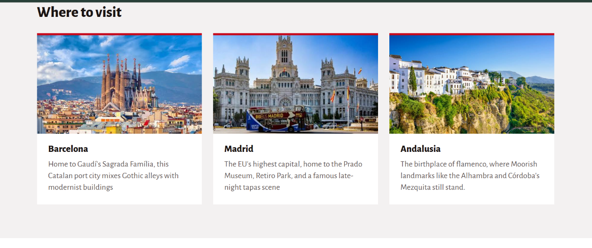
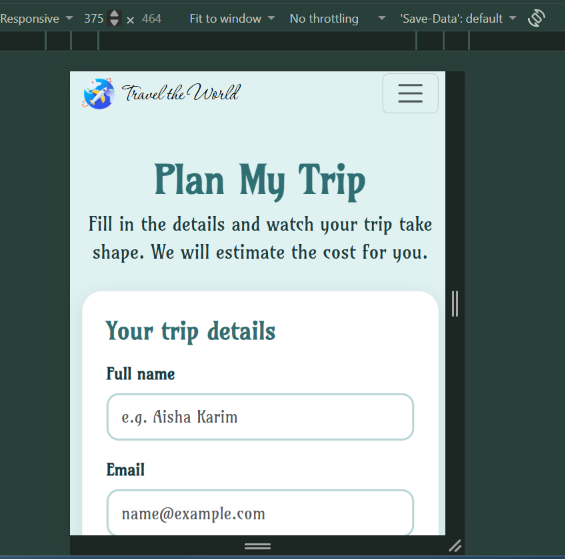

# Travel the World

An interactive travel website built with **Blazor WebAssembly (.NET 8)**. Pick a country on the world map, explore its food and places, search dishes and sights, check the live weather in 11 capital cities, play two geography games, and plan a trip with a live cost estimate.

> Final project for the C# / Blazor course. Authors: **Shatha Jawas** and **Shahd Jawas**.

**Live demo:** 
**Repository:** https://github.com/5ha7ha/IFP_Final_World.git

---

## Table of contents

1. [Features](#features)
2. [Screenshots](#screenshots)
3. [Tech stack](#tech-stack)
4. [Getting started](#getting-started)
5. [User guide](#user-guide)
6. [Architecture](#architecture)
7. [State management](#state-management)
8. [Error handling](#error-handling)
9. [Responsiveness and accessibility](#responsiveness-and-accessibility)
10. [Testing](#testing)
11. [Quality assurance](#quality-assurance)
12. [Developer notes](#developer-notes)
13. [Known limitations and future work](#known-limitations-and-future-work)
14. [Credits](#credits)

---

## Features

| Area | What it does |
|---|---|
| **Home** | Clickable world map, search section, live weather cards, and a "How many ___ in the world?" facts table |
| **Country pages** | Capital, languages, currency, a national quote (right-to-left for Arabic), "Did you know?" facts, local food, places to visit. Each country has its own color theme |
| **Search** | Searches dishes and places by name, description or country. Filter by Food or Places. Results update while typing |
| **Weather** | Current temperature and conditions for 11 capital cities, from the free Open-Meteo API |
| **Higher or Lower** | Guess whether the next country has a higher or lower population. 3 lives, streak and best streak |
| **Quiz** | 8 questions about Yemen, South Korea, Kazakhstan and Spain. 3 lives, a one-time 50/50 hint, score and percentage |
| **Plan My Trip** | Form with live validation and a live summary card. The cost is calculated from the country's daily price, travel style, days and travelers |

Supported destinations: Yemen, Spain, Kazakhstan, Korea, Japan, Germany, USA, Canada, Russia, Brazil and Saudi Arabia.

## Screenshots






## Tech stack

- **Framework:** Blazor WebAssembly, .NET 8, C#
- **UI:** Bootstrap 5.3, custom CSS (`stylesheet.css`, `country.css`, `game.css`, `quiz.css`, `app.css`), Google Fonts
- **External API:** [Open-Meteo](https://open-meteo.com/) (no API key needed)
- **Testing:** xUnit
- **JavaScript:** a small `site.js` for decoration only (country theme colors, focus and scrolling). The app still works if it fails

## Getting started

### Requirements

- [.NET 8 SDK](https://dotnet.microsoft.com/download/dotnet/8.0) (Windows, macOS or Linux)
- Any modern browser (Chrome, Edge, Firefox, Safari)
- An internet connection for the weather (the rest works offline once loaded)

### Run the website

```bash
git clone https://github.com/5ha7ha/IFP_Final_World.git
cd IFP_Final_World/IFP_Final_World
dotnet run
```

Open the address shown in the terminal (usually `https://localhost:5001` or `http://localhost:5000`).

### Run the tests

```bash
cd TravelTheWorld.Tests
dotnet test
```

### Build for release

```bash
dotnet publish -c Release
```

The output in `bin/Release/net8.0/publish/wwwroot` is a static site. It can be hosted on GitHub Pages, Netlify, Azure Static Web Apps or any static web server.

## User guide

1. **Home.** Click a colored country on the map, or search for a dish or place. Weather cards show the current temperature in each capital.
2. **Search.** Type a word (for example `paella`, `canyon` or `Korea`). Use the "Show" dropdown to see only food or only places. Click "Visit ..." on a card to open the country page.
3. **Country page.** Read the facts, food and places. Use "Visit another country" at the bottom to switch, or "Plan a trip to ..." to start planning with the country already selected.
4. **Games.** Open **Games** in the menu. Your progress is kept while you move between pages. Press **Restart** or **Play again** to start over.
   - *Higher or Lower:* press Higher or Lower. Equal populations count as correct.
   - *Quiz:* pick an answer, read the fact, press Next. **50/50** removes two wrong answers and can be used once.
5. **Plan My Trip.** Fill in all fields. Errors appear when you leave a field and disappear as soon as the value is correct. The summary card on the right updates live. Press **Book my trip** to see the confirmation.

Validation rules:

| Field | Rule |
|---|---|
| Full name | At least 3 characters, letters and spaces only (Latin, Cyrillic and Arabic letters allowed) |
| Email | Must look like `name@example.com` |
| Phone | 7 to 15 digits, a `+` at the start is allowed |
| Start date | Must be in the future |
| Days | Whole number from 1 to 30 |
| Travelers | Whole number from 1 to 10 |

Cost formula: `daily price × style multiplier × days × travelers` (Budget ×1, Comfort ×1.6, Luxury ×2.5).

## Architecture

The code is separated into data, services, game rules and UI. The UI depends on interfaces, not on concrete classes.

```
TravelTheWorld/
├── Models/
│   └── Models.cs                  Country, ContentItem, SearchItem, WeatherInfo ...
├── Services/
│   ├── ICountryRepository.cs      + InMemoryCountryRepository.cs   (country, dish and place data)
│   ├── ISearchService.cs          + SearchService.cs               (text and type filter)
│   ├── IWeatherService.cs         + OpenMeteoWeatherService.cs     (HTTP call + cache)
│   ├── WeatherCodes.cs            weather code -> icon and text
│   ├── TripPlanner.cs             price calculation + form validation rules
│   ├── GameState.cs               keeps the games alive between pages
│   ├── JsRuntimeExtensions.cs     safe JS interop
│   └── Games/
│       ├── HigherLowerEngine.cs   + PopulationData.cs
│       └── QuizEngine.cs          + QuizData.cs
├── Pages/                         Home, CountryPage, Games, Plan
├── Components/                    FlagLink, SearchSection, SearchResultCard, WeatherSection,
│                                  WeatherCard, FactsSection, MapSection, HigherLowerGame,
│                                  QuizGame, PlanField, PlanSelect
├── Layout/                        MainLayout, NavMenu, SiteFooter
└── wwwroot/                       index.html, css/, js/, img/

TravelTheWorld.Tests/              xUnit tests
```

### Design decisions

- **Dependency inversion.** Pages ask for `ICountryRepository`, `ISearchService` and `IWeatherService` through dependency injection (`Program.cs`). To use a database or a JSON file instead of the in-memory data, write a new class that implements the interface and change one line.
- **Rules are separate from the UI.** `QuizEngine`, `HigherLowerEngine` and `TripPlanner` contain no Blazor code, so they are easy to unit test. The Razor components only display state and forward button clicks.
- **Small reusable components.** Components receive data through `[Parameter]` (marked `EditorRequired` when needed) and report back with `EventCallback`. For example, `PlanField` is used for 6 different form fields.
- **Single responsibility.** Weather loading lives in `WeatherCard`, each card loads its own data and can fail on its own without breaking the page.

## State management

- **`GameState`** is registered as a **singleton** in `Program.cs`. It holds one `HigherLowerEngine` and one `QuizEngine`, so a game in progress is not lost when the user visits another page and comes back.
- **Form state** on the Plan page is kept in the page (`_values`, `_errors`, `_checked`). The live summary and cost are computed values derived from it, so they are always consistent with the form.
- **URL state:** the selected country is carried in the query string (`/country?c=spain`, `/plan?c=spain`) with `[SupplyParameterFromQuery]`, so pages can be bookmarked and shared.
- **Navigation menu state** (open or closed on mobile) is kept in C#, so Bootstrap's JavaScript bundle is not needed.

## Error handling

- **Weather:** network errors, bad JSON or an empty answer show "Weather unavailable" on that card only. Requests are cancelled if the component is removed.
- **Unknown country in the URL:** the country page shows a picker with all countries instead of an error.
- **Search:** empty input shows a hint, no matches shows "Nothing found for ...".
- **Forms:** every field is validated with a clear message. The first invalid field gets focus on submit.
- **Games:** invalid moves (answering twice, guessing after game over, using 50/50 twice) show a message and never change the game state.
- **JavaScript:** theme colors, focus and scrolling are decoration. If the JS call fails, the page still works.
- **Global:** Blazor's `#blazor-error-ui` banner appears on unexpected errors and offers a reload.

## Responsiveness and accessibility

- Bootstrap grid (`col-12 col-md-*`, `col-lg-*`) and a collapsing navigation bar for phones and tablets.
- Form fields and game cards stack on small screens.
- Accessibility: labels linked to inputs, `aria-live` regions for search count, quiz feedback and booking confirmation, `aria-label` on the map and menu button, descriptive `alt` text, `lang` and `dir` on quotes (Arabic reads right to left), keyboard focus moves to the next useful element in the quiz.

## Testing

The project has **76 automated tests** (xUnit), all passing:

| Test class | What it checks |
|---|---|
| `QuizEngineTests` | Score, lives, answering twice, 50/50 hint rules, winning, losing, restart |
| `HigherLowerEngineTests` | Streaks, best streak, lives, equal values, game over, restart, next country never equals current |
| `TripPlannerTests` | Price formula for all styles, invalid input returns 0, every validation message |
| `DataAndSearchTests` | Every dish and place has a country, every country has content, case-insensitive search, type filter, search by country |
| `WeatherTests` | Weather code descriptions, JSON parsing with a **fake HTTP handler** (no internet needed), decimal point in the URL, empty answer returns null |

Tests use a fixed `Random` seed so they give the same result on every run.

```bash
cd TravelTheWorld.Tests
dotnet test
```

**Coverage:**

```bash
dotnet test --collect:"XPlat Code Coverage"
```
**Coverage (Coverlet + ReportGenerator, 15 Nov 2026):**

| Scope | Line coverage | Branch coverage | Method coverage |
|---|---|---|---|
| Logic layer (Services and Models) | 92.4% (565 of 611 lines) | 90% (135 of 150) | 89.5% (77 of 86) |
| Whole project | 56.3% (565 of 1,002 lines) | 45.9% (135 of 294) | 42% (77 of 183) |

The game engines, trip planner, search and weather logic are well covered by unit tests. Razor components and `Program.cs` are not yet covered by automated tests, which is why the whole-project number is lower.

## Quality assurance

Manual testing results (checked: all pages, map and flag links, search and filter, weather cards, both games, Plan My Trip form with validation and booking):

| Browser / device | Result | Notes |
|---|---|---|
| Chrome (Windows) | Works | All pages and features work as expected |
| Edge (Windows) | Works | Same behavior and styling as Chrome |
| Phone-sized screen (browser device mode) | Works | Menu collapses into a button, weather cards show 2 per row, forms and game cards stack in one column |
| Tablet-sized screen (browser device mode) | Works | Same features and styling, layout adapts to fewer columns and rows |

Issues found and fixed:

| # | Problem | Fix |
|---|---|---|
| 1 | spaces when change to different screen size | fixed the css and some other files that conncected

## Developer notes

**Add a new country**

1. Add a `Country` entry (and its dishes and places) in `InMemoryCountryRepository.cs`.
2. Add its daily price in `TripPlanner.DailyCost` so it appears on the Plan page.
3. Add its capital coordinates in `WeatherSection.razor` for a weather card.
4. Put its images in `wwwroot/img/<Country>/`.

The existing test `EveryTripPrice_HasAMatchingCountry` and `EveryCountry_HasDishesAndPlaces` will catch missing data.

**Add a quiz question:** add a `QuizQuestion` in `QuizData.cs`. The `Correct` value is the zero-based index of the right option.

**Add a population entry:** add a `PopulationEntry` in `PopulationData.cs` (population in millions).

**Replace the data source:** implement `ICountryRepository`, then change the registration in `Program.cs`.

## Known limitations and future work

- Country data and trip prices are stored in C# code. Moving them to JSON or a database would make adding content easier.
- Game progress is kept only while the browser tab stays open (it is not saved to local storage).
- The booking is a demo: nothing is sent or stored.
- Prices are estimates in US dollars.
- Ideas: save games and trip plans in local storage, more quiz questions, offline support (PWA), user accounts.

## Credits

- Weather data: [Open-Meteo](https://open-meteo.com/)
- UI: [Bootstrap](https://getbootstrap.com/), Google Fonts
- Images: Google
- Code and text help: Claude (Anthropic)

&copy; 2026 Shatha Jawas and Shahd Jawas. All rights reserved.